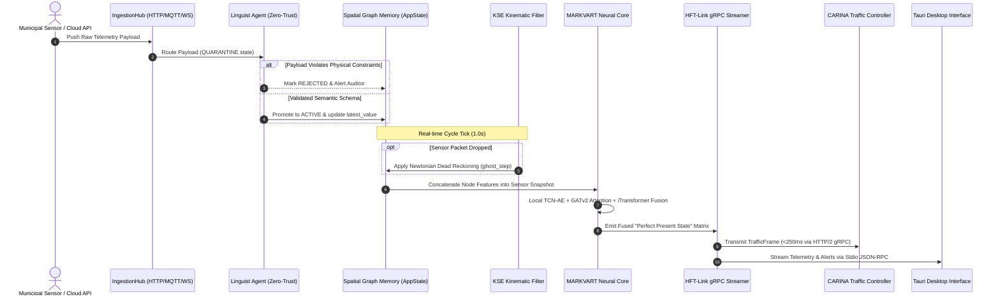

# SYNAPSE Core Architecture (Low Level)

> **Low-Level Architectural Dissection of the Intelligent Perception & Neural Fusion Gateway**

---

> 🧭 **Navigation**:
> [🏠 Synapse Core](README.md) • [🏗️ Architecture](ARCHITECTURE.md) • [📚 Docs Index](docs/README.md) • [🧠 Neural Models](docs/03_neural_models.md) • [⚡ HFT-Link](proto/README.md) • [🖥️ Desktop UI](ui/README.md) • [🧪 Testing](tests/README.md) • [📜 License](LICENSE)

---

## 1. Annotated Directory Structure

The SYNAPSE repository is structured strictly around **Domain-Driven Design (DDD)**, **Clean Architecture**, and **Hexagonal / Onion Architecture** principles. The backend PyTorch cognitive engine is completely decoupled from the modern native desktop interface.

```text
Synapse/
├── [src/](src/README.md)                      # Python Core Backend (Inference, Domain, IPC)
│   ├── [domain/](docs/01_domain_entities.md)      # Core entities, repositories, AppState facade
│   ├── [models/](docs/03_neural_models.md)      # Pure PyTorch neural network definitions (PINO, DeepONet, iTransformer)
│   ├── agents/               # MARKVART™ autonomous agents managing models & training loops
│   ├── blocks/               # Modular DL blocks (Graph, Spectral, Temporal)
│   ├── controllers/          # Application controllers (System, Project, View)
│   ├── engine/               # Real-time inference engine, cycle runner, and routing
│   ├── fenix/                # F.E.N.I.X. self-healing drift monitor & out-of-process watchdog
│   ├── infrastructure/       # gRPC HFT-Link connector, Postgres Data Lake, SafeTensors IO
│   ├── [ipc/](src/README.md#-core-subsystems-in-detail)                 # StdioDaemon, JSON-RPC protocol, and EventBridge
│   ├── kse/                  # Kinematic State Estimation (Kalman Dead Reckoning)
│   ├── [phases/](docs/04_execution_phases.md)              # ADAGIO™ execution phases (Phase 0, Phase 1, Phase 2)
│   ├── physics/              # LWR continuum conservation equations, Fundamental Diagrams
│   ├── pipeline/             # Multi-agent execution pipelines (Fusion, Specialist)
│   └── services/             # Domain and infrastructure services
├── [ui/](ui/README.md)                       # Frontend Desktop Application (Tauri v2 + React 18)
│   ├── src-tauri/            # Rust native backend, process manager, and Stdio pipes
│   └── src_ui/               # React 18, TypeScript, Tailwind CSS, Zustand stores, ECharts
├── [proto/](proto/README.md)                    # Protocol Buffers v3 definitions for HFT-Link gRPC
├── [Model_Vault/](Model_Vault/README.md)              # Pre-trained weights (SafeTensors, GGUF tokenizers)
├── [observability/](observability/README.md)            # Prometheus, Grafana, TensorBoard docker orchestration
├── [packaging/](packaging/README.md)                # Native Debian (.deb) builder & Dockerfile
├── [tests/](tests/README.md)                    # Test suites, mocks, benchmarks, and fixtures
└── [docs/](docs/README.md)                     # Comprehensive 7-chapter technical library
```

---

## 2. Design Patterns Applied

SYNAPSE strictly adheres to **SOLID** principles by leveraging well-defined architectural patterns:

### The Facade Pattern
- **`AppState` (`src/domain/app_state.py`)**: Acts as a thread-safe facade protecting the `TopologyRepository` and `SourceRepository`. External services never modify in-memory repositories directly; all state transitions flow through `AppState` to guarantee Zero-Trust validation.
- **`StdioDaemon` (`src/ipc/stdio_daemon.py`)**: A headless facade coordinating standard I/O streams, command routing, and domain event bridging without opening TCP/HTTP server ports on the host system.

### The Strategy & State Patterns
- **`SourceStatus` State Machine**: Data sources transition strictly through:
  $$\text{QUARANTINE} \longrightarrow \text{VALIDATING} \longrightarrow \text{ACTIVE} \rightleftharpoons \text{FALLBACK} \longrightarrow \text{PROBATION} \lor \text{REJECTED}$$
- **Graceful Degradation (Gating Policy)**: When a sensor drops packets or fails physical checks, the `gating_policy.py` strategy selects between Neural Inference (`ACTIVE`), Kinematic Dead Reckoning (`KSE`), or Micro-Estimation History (`MEH/AFB`).

### Dependency Injection (DIP) & IoC Containers
High-level orchestrators (`InferenceEngine`, `RuntimeLauncher`, `CycleProcessor`) never hardcode model instantiations or database connectors. Dependencies are injected via constructors (`ServiceContainer` and `ControllerFactory`), allowing full testing with mocks on CPU without spinning up PostgreSQL or CUDA runtimes.

### Process Supervision (Watchdog Pattern)
- **`FenixProcessSupervisor` (`src/fenix/process_supervisor.py`)**: Executes as an independent watchdog process (`python synapse.py --supervisor`), monitoring the neural core's health, memory ceilings, and auto-resurrecting it upon fatal crashes.

---

## 3. Desktop UI & IPC Architecture

Rather than opening localhost HTTP or WebSocket sockets that introduce security vulnerabilities in municipal control rooms, SYNAPSE implements **Zero-Network-Port IPC**:

```
┌────────────────────────────────────────────────────────────────────────┐
│                        TAURI v2 DESKTOP HOST                           │
│                                                                        │
│   ┌──────────────────────────────────────────────────────────────┐     │
│   │                      REACT 18 WEBVIEW                        │     │
│   │  - Zustand Reactive Stores (Sensors, System, Topology, XAI)  │     │
│   │  - ECharts Telemetry & Interactive Map Canvas                │     │
│   │  - KaTeX Mathematical Proofs & Jurist Reports                │     │
│   └──────────────────────────────┬───────────────────────────────┘     │
│                                  │ Tauri Invoke / Event Bridge         │
│   ┌──────────────────────────────▼───────────────────────────────┐     │
│   │                      RUST CORE (src-tauri)                   │     │
│   │  - Sidecar Process Manager (spawns Python StdioDaemon)       │     │
│   │  - Non-blocking async Stdio Pipe Interceptor                 │     │
│   └──────────────────────────────┬───────────────────────────────┘     │
└──────────────────────────────────┼─────────────────────────────────────┘
                                   │ STDIN / STDOUT (Newline JSON-RPC)
┌──────────────────────────────────▼─────────────────────────────────────┐
│                       PYTHON BACKEND (StdioDaemon)                     │
│  - CommandRouter, IpcEventBridge, AppState, PyTorch Inference Loop     │
└────────────────────────────────────────────────────────────────────────┘
```

For complete implementation specifics, see [`docs/02_ui_architecture.md`](docs/02_ui_architecture.md) and [`ui/README.md`](ui/README.md).

---

## 4. The Data Flow Pipeline (End-to-End)

Understanding how a single speed reading from an inductive loop or traffic camera becomes a macroscopic network state optimization:



1. **Ingestion (`src/adapters/`)**: A telemetry packet arrives via HTTP push/poll, MQTT stream, or WebSocket feed.
2. **Zero-Trust Validation (`src/agents/linguist_agent.py`)**: If the sensor is in `QUARANTINE`, the `Standby Linguist Thread` processes the schema through `DistilRoBERTa` and symbolic physics rules.
3. **Graph State Memory (`src/domain/app_state.py`)**: Upon validation, the reading updates the corresponding `MapNode` state in memory.
4. **Local Feature Extraction (`src/agents/specialist_agent.py`)**: Each node executes its local `TCNAE` autoencoder to generate temporal representations.
5. **Kinematic Protection (`src/kse/`)**: If packets are dropped, the `Extended Kalman Filter` extrapolates the speed and density vectors to avoid `NaN` tensors.
6. **Topological Aggregation (`src/agents/coordinator_agent.py`)**: `GATv2 Lite` propagates attention across road edges (`MapEdge`).
7. **Global Neural Fusion (`src/agents/fuser_agent.py`)**: `iTransformer` and `PINO` fuse temporal tokens into a single snapshot matrix.
8. **Transport (`src/infrastructure/grpc_connector.py`)**: The snapshot is serialized into `TrafficFrame` protobufs and streamed to CARINA over the `HFT-Link` in $< 250\text{ ms}$.
9. **Desktop Telemetry (`src/ipc/event_bridge.py`)**: Real-time metrics are streamed over standard I/O pipes to the Tauri interface at 60 FPS.

---

## 5. Subsystem Reference Links

For granular mathematical formulations, data schemas, and deployment instructions:
- [01. Domain Entities & Core Structures](docs/01_domain_entities.md)
- [02. UI Architecture & Frontend](docs/02_ui_architecture.md)
- [03. Neural Models & PyTorch Implementations](docs/03_neural_models.md)
- [04. Execution Phases & Lifecycle](docs/04_execution_phases.md)
- [05. Data Ingestion & HFT Network](docs/05_data_ingestion_and_hft.md)
- [06. Developer Guide (Protobuf & Testing)](docs/06_developer_guide.md)
- [07. Production Deployment Guide](docs/07_deployment_guide.md)

---

<p align="center">
  <sub>SYNAPSE Core Architecture — Noxfort Systems Engineering</sub><br/>
  <sub><a href="#synapse-core-architecture-low-level">Back to top ↑</a></sub>
</p>
