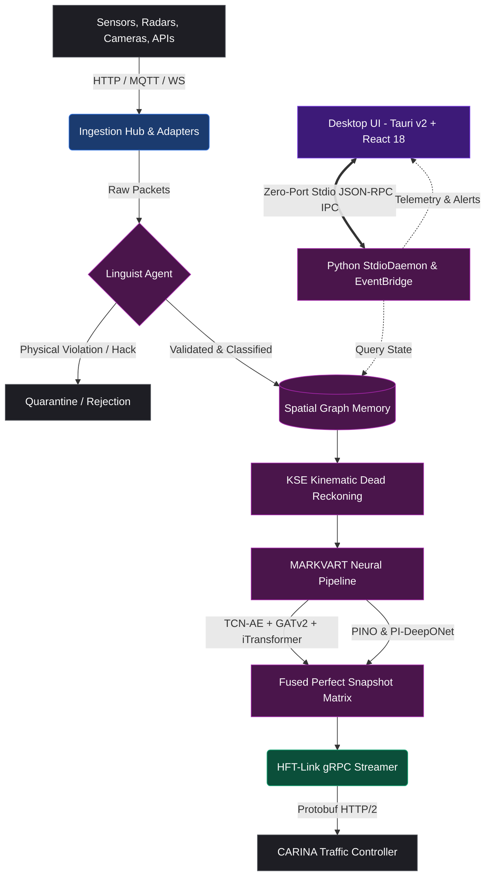

<div align="center">


# SYNAPSE CORE
### Intelligent Perception & Neural Fusion Gateway for Smart City Traffic Management
*Noxfort Systems — A State Of Art Company*

[](https://github.com/Noxfort-Systems-Brazil/SYNAPSE)
[](https://github.com/Noxfort-Systems-Brazil/SYNAPSE/actions/workflows/ci.yml)
[](https://github.com/Noxfort-Systems-Brazil/SYNAPSE/actions/workflows/security-codeql.yml)
[](https://python.org/)
[](https://rust-lang.org/)
[](https://pytorch.org/)
[](LICENSE)

[](https://github.com/Noxfort-Systems-Brazil/SYNAPSE)

---

🌐 **Translations:** **[🇺🇸 English](README.md)** • **[🇧🇷 Português do Brasil](docs/pt-br/README.md)** • **[🇪🇸 Español](docs/es/README.md)** • **[🇫🇷 Français](docs/fr/README.md)** • **[🇷🇺 Русский](docs/ru/README.md)** • **[🇨🇳 简体中文](docs/zh/README.md)** • **[📚 Documentation Hub](docs/README.md)**

---

</div>

> 🧭 **Quick Navigation**:
> [📖 Summary](#-executive-summary) • [🏗️ Architecture](ARCHITECTURE.md) • [🧠 Neural Models](docs/03_neural_models.md) • [⏱️ Execution Phases](docs/04_execution_phases.md) • [⚡ HFT-Link](proto/README.md) • [🖥️ Desktop UI](ui/README.md) • [🧪 Testing](tests/README.md) • [📚 Docs Library](docs/README.md) • [🤝 Contributing](CONTRIBUTING.md) • [📜 License](LICENSE)

---

## 📖 Executive Summary

**SYNAPSE CORE** is an enterprise-grade, real-time AI perception and neural fusion platform developed by **Noxfort Systems**. It serves as the primary sensory and cognitive gateway for modern Smart City architectures. 

SYNAPSE continuously ingests massive, heterogeneous, asynchronous data streams from municipal sensors (cameras, radar, induction loops, Bluetooth/BLE beacons) and external cloud APIs (Waze, TomTom, OpenStreetMap, SUMO traffic networks). 

Using **MARKVART™** (a modular ensemble of 10 deep neural architectures, physics-informed operators, and deterministic geometric spatial engines), SYNAPSE reconstructs a mathematically sound, fluid-dynamically validated state of the entire urban traffic grid. This synthesized snapshot is transmitted via **HFT-Link** (an ultra-low-latency gRPC stream) to downstream traffic light controllers such as **CARINA** for macroscopic phase and green-wave optimization.

```
                  ┌────────────────────────────────────────────────────────┐
                  │                 SYNAPSE CORE v2.0                      │
                  │  ┌──────────────┐   Zero-Port    ┌──────────────────┐  │
                  │  │  Tauri v2 UI │ ◄────────────► │   Stdio Daemon   │  │
                  │  │  (React 18)  │    JSON-RPC    │  (Python Core)   │  │
                  │  └──────────────┘                └────────┬─────────┘  │
                  └───────────────────────────────────────────┼────────────┘
                                                              │
   ┌──────────────────────┐      ┌─────────────────────────┐  │  ┌──────────────────────┐
   │ Heterogeneous Inputs │ ───► │  Zero-Trust Gatekeeper  │ ─┴─►│ MARKVART™ Neural Stack│
   │ Cameras, Radars,     │      │  (NeuroSymbolic Distil) │     │ (PINO, DeepONet, iTrans)
   │ Loops, Waze, TomTom  │      └─────────────────────────┘     └──────────┬───────────┘
   └──────────────────────┘                                                 │
                                                                 ┌──────────▼───────────┐
                                                                 │ HFT-Link gRPC Stream │
                                                                 │ (< 250ms latency)    │
                                                                 └──────────┬───────────┘
                                                                            │
                                                                 ┌──────────▼───────────┐
                                                                 │  CARINA Controller   │
                                                                 └──────────────────────┘
```

---

## 🏗️ System Architecture

SYNAPSE adheres strictly to **Domain-Driven Design (DDD)**, **Clean Architecture**, and **SOLID** principles, ensuring full decoupling between ingestion, neural inference, background daemon orchestration, and the high-performance desktop interface:



---

## 🧠 Neural Architecture Stack (MARKVART™)

The **Modular Adaptive Reasoning Kernel with Variational Attention & Recurrent Transformers (MARKVART™)** deploys 10 specialized neural networks alongside deterministic spatial indexing across three semantic levels:

| Model | Subsystem / Agent | Mathematical Formulation / Paradigm | Primary Responsibility |
| :--- | :--- | :--- | :--- |
| **PINO-Traffic** | Continuum Operator | Fourier Neural Operator (FNO) + Lighthill-Whitham-Richards (LWR) PDE Constraints | Physics-informed macroscopic traffic flow simulation and shockwave modeling across road networks. |
| **PI-DeepONet** | Continuous Estimator & Imputer | Physics-Informed Deep Operator Network with dual Branch/Trunk architectures | Solves continuous velocity/density fields and imputes missing telemetry over prolonged sensor outages. |
| **PI-DVAE-TCN** | Corrector Agent | Denoising Variational Autoencoder with Dilated Causal Convolutions & Kinetic Loss | Filters sensor noise, eliminates measurement jitter, and reconstructs clean trajectories with physical conservation guarantees. |
| **iTransformer** | Fuser Agent | Inverted Multi-Variate Transformer with Spatio-Temporal Cross-Attention | Global temporal fusion treating variates as tokens, cross-attending with spatial graph embeddings. |
| **GATv2 Lite / Diffusion**| Coordinator Agent | Dynamic Graph Attention Networks v2 with 5D Physical Edge Tensor & 8-Hop Diffusion | Captures non-Euclidean spatial relationships, congestion propagation, and arterial bottlenecks across city topology. |
| **FastMapMatcher** | Spatial Alignment (Linguist) | Spatial Indexing (R-Tree) + Fréchet Distance & Directional Vectorization | Performs ultra-fast, deterministic CPU map-matching, aligning external GPS/telemetry traces to exact street graph edges. |
| **SpectralFeatureBlock** | Periodicity Engine | 1D Fourier Spectral Convolutions (`SpectralConv1d`) | Deconstructs multi-frequency periodic patterns (e.g., morning rush, weekend dips, school holidays). |
| **WaveletAE-OCC** | Auditor Agent | Discrete Wavelet Transform Autoencoder + Deep One-Class Classification | High-frequency frequency-domain anomaly detection, identifying faulty sensors, hacks, or unusual grid disruptions. |
| **ModernBERT & NeuroSymbolic** | Gatekeeper & Classifier | ModernBERT Transformer Backbone + Decoupled TCNAE + 3D Physics Projection Head | Zero-trust semantic and physical validation of incoming sensor schemas with LWR conservation loss penalties. |
| **Qwen3 (1.7B / 2B)** | Jurist Agent | Quantized LLM (GGUF / SafeTensors) with Sub-Process Fault Isolation | Generates legal-grade, explainable AI (XAI) audit reports and natural language justifications in 6 languages. |

For full mathematical derivations, equations, and loss formulations, refer to the [Neural Models Documentation](docs/03_neural_models.md).

---

## ⏱️ Execution Phases (ADAGIO™)

SYNAPSE operates through a structured execution pipeline called **ADAGIO™** (*Automated Data Analysis, Generation & Inference Orchestration*):

1. **Phase 0 — Optimization & Calibration (`OptimizationPhase`)**:
   - Executes automated hyperparameter tuning via **Optuna** Bayesian optimization.
   - Calibrates baseline sensor variance, latent dimensions, and anomaly detection thresholds.
2. **Phase 1 — Offline Bootstrap (`BootstrapPhase`)**:
   - Generates historical *Golden Datasets* from partitioned `.parquet` files.
   - Computes **MEH** (*Micro-Estimation History*) matrices and enforces *Ghost-File* memory protections.
3. **Phase 2 — Online Runtime (`RuntimePhase`)**:
   - Launches the **4-Thread Real-Time Concurrency Architecture**:
     - 📥 **Ingestion Worker Thread**: Asynchronously consumes HTTP, MQTT, and WebSocket sensor payloads.
     - 🛡️ **Standby Linguist Thread**: Zero-trust validation and schema sanitization of quarantined data.
     - 🧠 **Neural Core Inference Thread**: High-throughput GPU execution of MARKVART™ and KSE dead reckoning.
     - ⚖️ **XAI Jurist Worker Thread**: Non-blocking asynchronous generation of natural language audit logs.

For detailed sequence diagrams, see [Execution Phases](docs/04_execution_phases.md).

---

## ⚡ HFT-Link & Resilient Self-Healing

SYNAPSE guarantees uninterrupted traffic control data transmission via the **High-Frequency Transport Link (HFT-Link)**:

- **Protocol**: High-speed gRPC over HTTP/2 with binary Protocol Buffers (`proto/synapse_hft.proto`).
- **Payload Capacity**: Configured with a 50MB maximum message limit to support whole-metropolis topological graphs and high-density telemetry in a single frame.
- **Latency Guarantee**: End-to-end cycle delivery in $< 250\text{ ms}$.
- **Zero-Downtime Auto-Recovery**: If the downstream controller (CARINA) restarts or drops network packets, SYNAPSE caches binary maps in memory and loops in a non-blocking background thread (`hft_recovery.py`), transparently re-uploading the network scenario and re-arming the streaming pipeline the millisecond the connection restores.

---

## 🖥️ Modern Desktop Interface (Tauri v2 + React 18)

The frontend is a dedicated, native desktop application engineered with **Tauri v2** and **React 18**:

- **Zero-Port IPC Security**: Frontend communicates with the Python core exclusively through standard streams (`stdin`/`stdout`) via the `StdioDaemon` JSON-RPC protocol, eliminating local network port vulnerabilities.
- **Dynamic Theming**: Full Dark/Light theme switching powered by Tailwind CSS.
- **Multi-Language Localization**: Native Portuguese (`pt_BR`) and English (`en_US`) locales, architected for effortless multi-lingual expansion.
- **High-Rate Telemetry**: Hardware-accelerated Echarts render live queue lengths, occupancy graphs, and sensor confidence metrics.
- **Decoupled Event Bridge**: The core PyTorch inference cycle is completely isolated from GUI rendering threads.

---

## 🛠️ Installation & Setup

### Hardware Requirements

| Component | Minimum Specification | Recommended Specification |
| :--- | :--- | :--- |
| **CPU** | 8 Cores (x86_64) | 16+ Cores (AMD Ryzen 9 / Intel i9 / Xeon) |
| **RAM** | 16 GB | 32 GB DDR4/DDR5 |
| **GPU** | NVIDIA GPU with 8 GB VRAM (CUDA 12.x) | NVIDIA RTX 3090 / 4090 / A5000 (16+ GB VRAM) |
| **Storage** | 20 GB free NVMe SSD | 100 GB+ NVMe SSD (for large historical Parquet files) |
| **OS** | Ubuntu 22.04 LTS (Jammy) | Ubuntu 22.04 / 24.04 LTS |

---

### Step-by-Step Installation

#### 1. Clone the Repository
```bash
git clone https://github.com/Noxfort/Synapse.git
cd Synapse
```

#### 2. Configure Python Virtual Environment
```bash
python3 -m venv .venv
source .venv/bin/activate
pip install --upgrade pip
pip install -r requirements.txt
```

#### 3. (Optional) Install Frontend Dependencies (For Desktop UI Development)
If you wish to build or develop the Tauri v2 desktop application:
```bash
# Ensure Rust and Node.js are installed
curl --proto '=https' --tlsv1.2 -sSf https://sh.rustup.rs | sh -s -- -y
source "$HOME/.cargo/env"

# Install UI npm packages (from repository root)
npm install
# or from ui/ directory
cd ui && npm install && cd ..
```

#### 4. Configure Pre-Trained Weights (Model Vault)
SYNAPSE relies on foundational language and transformer weights stored in `Model_Vault/`.
- Ensure `Model_Vault/distilroberta/` contains `model.safetensors`, `config.json`, `tokenizer.json`, etc.
- Ensure `Model_Vault/Qwen3.5-2B-UD-Q6_K_XL.gguf` (or `Model_Vault/qwen3_1.7B/`) is present.
- For detailed instructions, refer to [`Model_Vault/README.md`](Model_Vault/README.md).

---

## 🚀 Running SYNAPSE

### 1. Launch Modern Desktop Interface
```bash
# Option A: From root using Python (auto-detects Tauri release/dev or launches daemon)
python synapse.py

# Option B: Launch native Tauri v2 desktop frontend with live hot-reload
npm run tauri dev
```

### 2. Launch in Headless Daemon Mode (Servers & Production)
For containerized cloud deployments or background edge servers without graphical displays:
```bash
# Run headless IPC daemon
python synapse.py --daemon
# OR
python synapse.py --headless
# OR
SYNAPSE_HEADLESS=1 python synapse.py
```

### 3. Launch Out-of-Process Watchdog Supervisor (F.E.N.I.X.)
For high-availability mission-critical deployments where the neural core process must be auto-resurrected upon unexpected faults:
```bash
python synapse.py --supervisor
```

### 4. Run Observability Stack (Prometheus + Grafana + TensorBoard)
```bash
docker compose -f observability/docker-compose.yml up -d
```
- **Grafana**: [http://localhost:3000](http://localhost:3000) (User: `admin` | Password: `synapse123`)
- **Prometheus**: [http://localhost:9090](http://localhost:9090)
- **TensorBoard**: [http://localhost:6006](http://localhost:6006)
- Complete details in [`observability/README.md`](observability/README.md).

---

## 🧪 Testing & Validation

SYNAPSE includes a comprehensive test suite covering unit logic, integration pipelines, and hardware stress benchmarks:

```bash
# Run all unit and integration tests
pytest tests/ -v

# Run with coverage report
pytest --cov=src tests/

# Run sensor stress benchmark (simulate sensors under full load)
python tests/benchmark.py
```

For complete details on testing mocks and fixtures, see [`tests/README.md`](tests/README.md).

---

## 📂 Repository Directory Map

```text
Synapse/
├── [Model_Vault/](Model_Vault/README.md)       # Foundation neural weights (SafeTensors, GGUF, tokenizers)
├── [bin/](bin/)                         # Pre-compiled high-performance binaries (synapse-gateway, caddy)
├── [config/](config/)                    # Configuration files (settings.ini, Caddyfile, report templates)
├── [docs/](docs/README.md)              # Technical documentation library (01 to 07)
├── [observability/](observability/README.md)     # Prometheus, Grafana, TensorBoard docker orchestration
├── [proto/](proto/README.md)             # Protobuf schemas for HFT-Link gRPC
├── [src/](src/README.md)               # Python Core Backend (Clean Architecture / DDD)
│   ├── adapters/          # Ingestion adapters (HTTP push/poll, MQTT, WS, Replay)
│   ├── afb/               # Adaptive Fallback Engine & SensorGuard
│   ├── agents/            # Autonomous MARKVART™ agents (Specialist, Fuser, Jurist, etc.)
│   ├── blocks/            # Neural building blocks (Graph, Spectral, Temporal)
│   ├── controllers/       # Business logic controllers (System, Project, View)
│   ├── database/          # Connection pool proxy, db engine, migrator, settings
│   ├── domain/            # Core entities, repositories, and AppState facade
│   ├── engine/            # Real-time inference engine, cycle runner, and routers
│   ├── factories/         # Factory patterns for agents, models, nodes, phases
│   ├── fenix/             # Self-healing, drift evaluation, and supervisor watchdog
│   ├── formatters/        # ABNT official report formatters (DOCX, HTML preview, Markdown)
│   ├── go/                # Subprocess transport, pipe dispatcher, and binary manager
│   ├── handlers/          # Command, database, DuckDNS, and system handlers
│   ├── [hft/](docs/05_data_ingestion_and_hft.md)             # High-Frequency Transport gRPC connector, streamer, recovery
│   ├── infrastructure/    # PostgreSQL data lake, SafeTensors storage, network services
│   ├── interfaces/        # Formal typing contracts and Abstract Base Classes (ABCs)
│   ├── ipc/               # StdioDaemon, JSON-RPC protocol, and EventBridge
│   ├── kse/               # Kinematic State Estimation (Kalman Dead Reckoning)
│   ├── linguist/          # Global cartographer matcher, compass reconciler, local topology matcher
│   ├── logging/           # Interceptor-based logging and log facades
│   ├── managers/          # Graph, Node, Storage, Source, and XAI managers
│   ├── meh/               # Micro-Estimation History & Golden Dataset loader
│   ├── memory/            # Episodic, Semantic, Spatial, Spatiotemporal memory
│   ├── mlops/             # Drift engine, loss engine, and automated MLOps pipelines
│   ├── models/            # PyTorch models (ModernBERT, PINO, DeepONet, iTransformer, GATv2)
│   ├── node/              # TrafficNode graph vertices, state, and step processing
│   ├── optimization/      # Optuna AutoML and Bayesian Hyperparameter Tuning
│   ├── orchestrators/     # HFT and lifecycle orchestrators
│   ├── phases/            # ADAGIO™ execution phases (0, 1, 2)
│   ├── physics/           # LWR continuum physics, fundamental diagrams, physical losses
│   ├── pipeline/          # Agent orchestration pipelines (Fusion, Specialist, Jurist)
│   ├── report/            # Municipal traffic kinematic reporting, jurist diagnosis, and attribution extraction
│   ├── security/          # Master auth, account manager, password policy, lockdown manager
│   ├── services/          # Domain services (FastMapMatcher, MapService, VirtualSensorService)
│   ├── slm/               # Small Language Model isolation subsystem (IsolatedJuristManager)
│   ├── storage/           # Checkpoint store, path scaffolder, snapshot store, vault sync
│   ├── strategies/        # Validation, imputation, and clustering strategies
│   ├── trainer/           # Neural training routines for agents
│   └── utils/             # Hardware acceleration, geometry, normalization helpers
├── [src_go/](src_go/README.md)               # High-Performance Sensor Ingestion Gateway & HTTPS/DuckDNS Tunnel
├── [tests/](tests/README.md)             # PyTest test suites, mocks, and stress benchmarks
├── [ui/](ui/README.md)                # Modern Desktop Frontend (Tauri v2 + React 18 + Vite)
│   ├── src-tauri/         # Rust native backend & sidecar manager
│   └── src_ui/            # React 18 components, Zustand stores, Echarts, Tailwind
├── synapse.py             # Main application launcher
└── [LICENSE](LICENSE)               # GNU AGPL v3.0 license definition
```

---

## 📚 Exhaustive Documentation Library

For granular mathematical, architectural, and operational manuals, explore the `docs/` library:

1. [01. Domain Entities & Core Structures](docs/01_domain_entities.md)
2. [02. UI Architecture & Frontend](docs/02_ui_architecture.md)
3. [03. Neural Models & PyTorch Implementations](docs/03_neural_models.md)
4. [04. Execution Phases & Lifecycle](docs/04_execution_phases.md)
5. [05. Data Ingestion & HFT Network](docs/05_data_ingestion_and_hft.md)
6. [06. Developer Guide (Protobuf & Testing)](docs/06_developer_guide.md)
7. [07. Production Deployment Guide](docs/07_deployment_guide.md)
8. [Comprehensive Documentation Index](docs/README.md)

---

## 🤝 Community & Governance

SYNAPSE CORE is an enterprise open-source project. We welcome contributions and peer review:
- [Contributing Guidelines](CONTRIBUTING.md)
- [Code of Conduct](CODE_OF_CONDUCT.md)
- [Security Policy](SECURITY.md)
- [Changelog](CHANGELOG.md)

---

## 📄 License

This software is licensed under the **GNU Affero General Public License v3.0 or later** (`AGPL-3.0-or-later`) — see the [LICENSE](LICENSE) file for complete details.

SPDX-License-Identifier: `AGPL-3.0-or-later`

---

<div align="center">
  <br/>
  <b>Noxfort Systems</b> — <i>A State Of Art Company</i><br/>
  <i>Intelligent Perception & Neural Fusion Gateway • SYNAPSE CORE v2.0</i><br/>
  <small>SPDX-License-Identifier: <a href="LICENSE"><code>AGPL-3.0-or-later</code></a> • © 2026 Noxfort Systems</small>
</div>