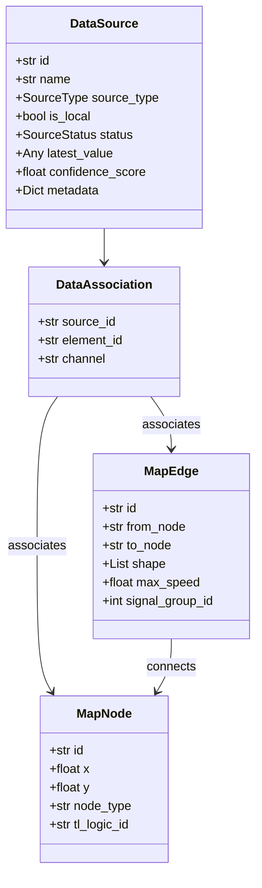
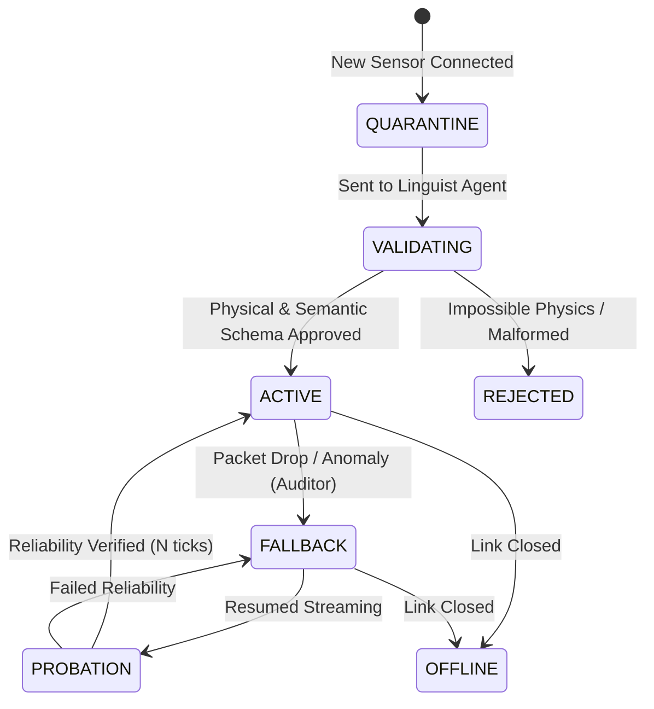

# 01. Domain Entities & Core Structures

> **Domain Entities, Topological Graphs, Bayesian Trust Hierarchy, and Zero-Trust State Machines**

---

> 🧭 **Navigation**:
> [🏠 Synapse Core](../README.md) • [📚 Docs Index](README.md) • [Next: 02. UI Architecture »](02_ui_architecture.md)

---

## 🏛️ Overview

Located primarily in [`src/domain/entities.py`](../src/domain/entities.py), the Domain models represent the absolute core of SYNAPSE's business logic. All peripheral components (Desktop UI, PyTorch models, gRPC clients, database persistence) depend on these structures, enforcing the **Dependency Inversion Principle (DIP)**.



---

## 🗺️ Topological Entities (The World)

SYNAPSE models the urban environment based on the SUMO `.net.xml` specification, but distills it into memory-efficient, immutable Python Dataclasses.

### 1. `MapNode`
Represents an urban traffic intersection or junction.
- **Attributes**:
  - `id: str` — Unique node identifier from the SUMO network (e.g., `"cluster_12048"`).
  - `x: float`, `y: float` — Projected UTM coordinates in meters.
  - `node_type: str` — Junction typology (`"traffic_light"`, `"priority"`, `"roundabout"`).
  - `real_name: Optional[str]` — Human-readable street name intersection.
  - `tl_logic_id: Optional[str]` — The Traffic Light Logic ID linking this node to the downstream [CARINA](05_data_ingestion_and_hft.md) controller.
- **Function**: During the Graph Attention phase ([`GATv2 Lite`](03_neural_models.md#2-spatial-reasoning-gatv2-lite-gatv2_litepy)), `MapNode`s act as the graph vertices holding the localized temporal embeddings generated by the [`TCNAE`](03_neural_models.md#3-local-feature-extraction--denoising-tcnae-tcn_aepy).

### 2. `MapEdge`
Represents a directional road segment connecting two intersections.
- **Attributes**:
  - `id: str` — Unique edge identifier (e.g., `"-edge_4401"`).
  - `from_node: str`, `to_node: str` — Source and target junction node IDs.
  - `shape: List[Tuple[float, float]]` — Detailed polyline geometry coordinates.
  - `length: float` — Physical segment length in meters.
  - `max_speed: float` — Speed limit in m/s (default $13.89\text{ m/s} \approx 50\text{ km/h}$).
  - `lanes: int` — Number of parallel vehicular lanes.
  - `signal_group_id: int` — NTCIP signal group phase controlling vehicular discharge into the junction.
- **Function**: `MapEdge`s dictate the flow of dynamic spatial attention. Arterial congestion on an edge propagates mathematically to upstream `from_node` vertices.

---

## 📡 Ingestion Entities (The Senses)

### 1. `DataSource`
The primary ingestion entity representing a physical telemetry device or external cloud service:

```python
@dataclass
class DataSource:
    id: str
    name: str
    source_type: SourceType = SourceType.API
    connection_string: str = ""
    is_local: bool = True
    
    # Zero-Trust Lifecycle State
    status: SourceStatus = SourceStatus.QUARANTINE
    
    # Spatial Positioning
    lat: float = 0.0
    lon: float = 0.0
    
    # Telemetry State (Flexible Schema)
    latest_value: Any = None
    last_update: float = 0.0
    
    # Semantic Metadata (Inferred by Linguist Agent)
    semantic_type: Optional[str] = None  # e.g., "speed", "occupancy", "flow"
    inferred_unit: Optional[str] = None  # e.g., "km/h", "veh/min", "pct"
    confidence_score: float = 0.0
    
    # Arbitrary Sensor Hardware Configurations
    metadata: Dict[str, Any] = field(default_factory=dict)
```

### 2. `SourceType` Enum
Defines the transport layer protocol supported by [`src/adapters/`](05_data_ingestion_and_hft.md):
- `CSV` — Static historical batch ingestion.
- `PARQUET` — High-performance columnar Data Lake storage.
- `API` — External REST API polling (Waze, TomTom, OpenData).
- `MQTT` — Low-overhead pub/sub IoT message broker stream.
- `DATABASE` — Relational SQL connection pool (PostgreSQL).
- `SUMO_NET_XML` — Microscopic traffic simulator network bridge.

### 3. `DataAssociation`
Maps an incoming telemetry feed to a physical road element:
```python
@dataclass
class DataAssociation:
    source_id: str
    element_id: str             # ID of MapNode or MapEdge
    channel: Optional[str] = None # Lane index or sub-channel identifier
```

---

## 🛡️ The Zero-Trust Security Pipeline

In municipal traffic deployments, field sensors are susceptible to physical defects, network drops, and malicious tampering. SYNAPSE treats all incoming telemetry as potentially hostile.

### `SourceStatus` State Machine



1. **`QUARANTINE`**: Initial state. Data is buffered in quarantine memory but blocked from updating graph state.
2. **`VALIDATING`**: The [`Linguist Agent`](03_neural_models.md) evaluates schema embeddings against `DistilRoBERTa` and verifies Newtonian physics bounds.
3. **`ACTIVE`**: Validation passed. Real-time telemetry flows to `MapNode` memory for neural inference.
4. **`FALLBACK`**: The sensor dropped packets or sent anomalous spikes. The system activates the Adaptive Fallback Engine (`AFB`) and defaults to [`KSE Dead Reckoning`](04_execution_phases.md#kse-dead-reckoning) or historical `MEH` tables.
5. **`PROBATION`**: Sensor restored communication, but must maintain continuous validity for $N$ consecutive cycles before returning to `ACTIVE`.
6. **`REJECTED`**: Detected physical impossibilities (e.g., speed > $200\text{ km/h}$ on residential streets or negative vehicle counts). Permanently quarantined.
7. **`OFFLINE`**: Connection terminated by administrator or transport timeout.

---

## ⚖️ Bayesian Trust Hierarchy

When resolving conflicting telemetry across overlapping sensors, the system applies hardcoded Bayesian priors:

$$\text{Confidence}_{\text{final}} = w_{\text{local}} \cdot \text{Trust}_{\text{local}} + w_{\text{global}} \cdot \text{Trust}_{\text{global}}$$

```python
LOCAL_TRUST_SCORE: float = 0.95   # Physical inductive loops, radars, cameras
GLOBAL_TRUST_SCORE: float = 0.60  # Crowdsourced cloud APIs (Waze, TomTom)
```
- **Physical Ground Truth**: Municipal hardware sensors (`is_local=True`) maintain highest priority ($0.95$).
- **Crowdsourced Feeds**: Cloud APIs (`is_local=False`) are susceptible to report latency and user GPS inaccuracy ($0.60$).

---

> 🧭 **Next Chapter**: Explore the modern desktop interface in [02. UI Architecture & Modern Frontend](02_ui_architecture.md).

---

<p align="center">
  <sub>SYNAPSE Documentation — Noxfort Systems</sub><br/>
  <sub><a href="#01-domain-entities--core-structures">Back to top ↑</a></sub>
</p>
