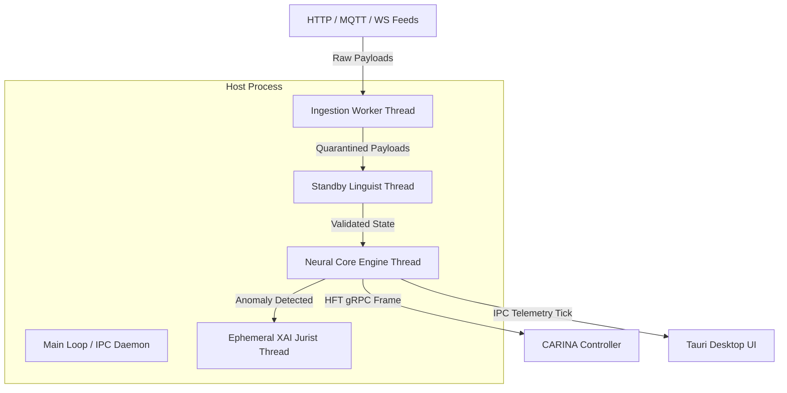

# 04. Execution Phases & Lifecycle (ADAGIO™)

> **The ADAGIO™ Pipeline: Optimization AutoML, Offline Bootstrap Golden Datasets, and 4-Thread Real-Time Concurrency Runtime**

---

> 🧭 **Navigation**:
> [🏠 Synapse Core](../README.md) • [📚 Docs Index](README.md) • [« Previous: 03. Neural Models](03_neural_models.md) • [Next: 05. Data Ingestion & HFT »](05_data_ingestion_and_hft.md)

---

## ⏱️ Overview: The ADAGIO™ Pipeline

The SYNAPSE lifecycle is orchestrated by **ADAGIO™** (*Automated Data Analysis, Generation & Inference Orchestration*). It structures execution into three isolated phases located in [`src/phases/`](../src/phases/):

```text
┌─────────────────────────────────────────────────────────────────────────────┐
│                             ADAGIO™ LIFECYCLE                               │
│                                                                             │
│   Phase 0: Optimization      Phase 1: Offline Bootstrap   Phase 2: Runtime  │
│   ┌─────────────────────┐    ┌────────────────────────┐   ┌───────────────┐ │
│   │ Optuna AutoML       │───►│ Historical Parquet     │──►│ 4-Thread Core │ │
│   │ Population Training │    │ Ghost-File Protection  │   │ KSE Kinematics│ │
│   │ Baseline Variance   │    │ SafeTensors Checkpoint │   │ HFT Streaming │ │
│   └─────────────────────┘    └────────────────────────┘   └───────────────┘ │
└─────────────────────────────────────────────────────────────────────────────┘
```

---

## 1. Phase 0: Optimization (`optimization_phase.py`)

Handles calculus-based AutoML and parameter calibration before starting online operations:
- **Prerequisites**: Requires at least one live local sensor (`is_local=True`), one global sensor feed, and the SUMO network topology (`MapNode`, `MapEdge`).
- **Execution Thread**: Launches `OptimizerService` inside a dedicated non-blocking thread (`opt_thread`).
- **Optuna Tuning**:
  - Uses the **Tree-structured Parzen Estimator (TPE)** algorithm to explore the hyperparameter space.
  - Automatically calibrates local [`TCNAE`](03_neural_models.md) channel depths, latent dimensions ($16 \dots 64$), and learning rates.
  - Calibrates baseline sensor variance $\sigma_{\text{base}}$ and anomaly detection boundaries in [`WaveletAE-OCC`](03_neural_models.md#9-waveletae-occ-high-frequency-anomaly-detector).
- **Population-Based Training (PBT)**: Dynamically mutates hyper-parameters for under-performing sensor nodes while copying weights from top-performing models.

---

## 2. Phase 1: Offline Bootstrap (`bootstrap_phase.py`)

Constructs the historical baseline ("Golden Dataset") from partitioned columnar `.parquet` files stored in the local Data Lake.

### 🛡️ Ghost-File Protection & Security Hardening
Training deep operators over gigabytes of traffic telemetry can take significant time. SYNAPSE implements an **Intelligent Skip** mechanism to bypass redundant training if the Data Lake is fully intact.

To prevent silent failures caused by power cuts or zero-byte filesystem corruption, `_check_existing_datalake()` enforces **Ghost-File Protection**:

```python
# A file existing on disk is not enough. It must not be an empty 0-byte ghost file.
ontology_valid = os.path.exists(safetensors_path) and os.path.getsize(safetensors_path) > 0
```

The system validates the complete security trifecta:
1. **Historical Telemetry Parquet Lake**: Clean, non-zero `.parquet` partitions.
2. **`ontology.safetensors`**: Pre-computed baseline weights stored in HuggingFace zero-copy format.
3. **`peak_schedule.json`**: The Master Lock file containing GMM-classified temporal schedules.

If any element is missing or truncated to 0 bytes, Phase 1 forcefully invalidates the cache and recompiles the Data Lake from raw database logs.

---

## 3. Phase 2: Online Runtime (`runtime_phase.py`)

The operational core of SYNAPSE. `RuntimePhase` coordinates two primary sub-systems:
1. **`RuntimeConnector`**: Manages the gRPC channel, telemetry buffering, and the [HFT-Link auto-recovery loop](05_data_ingestion_and_hft.md#auto-recovery-self-healing-loop).
2. **`RuntimeLauncher`**: Instantiates the `InferenceEngine` and spins up the multi-threaded concurrency model.

---

## 🧵 The 4-Thread Concurrency Architecture

To guarantee sub-250ms deterministic real-time execution, tasks are strictly segregated across four dedicated worker threads:



1. **📥 The Ingestion Worker Thread**:
   - Asynchronously consumes external HTTP endpoints, MQTT topics, and WebSocket connections without blocking memory queues.
2. **🛡️ The Standby Linguist Thread**:
   - Awakens exclusively when a sensor enters `QUARANTINE`.
   - Runs `DistilRoBERTa` semantic classification and Newtonian sanity checks without pausing the active graph.
3. **⚖️ The Ephemeral XAI Jurist Thread**:
   - When `WaveletAE-OCC` flags an anomaly, a dedicated thread is spawned on-demand to execute the quantized `Qwen3` LLM.
   - Compiles a legal report and terminates immediately, freeing CPU and VRAM.
4. **🧠 The Neural Core Engine Thread**:
   - Executes the deterministic, synchronous `CycleProcessor` loop at 1.0s or 0.1s intervals.
   - Evaluates active [`TCNAE`](03_neural_models.md#3-local-feature-extraction--denoising-tcnae-tcn_aepy) embeddings, [`GATv2 Lite`](03_neural_models.md#5-gatv2-lite--diffusion-gatv2-topological-reasoning), and [`iTransformer`](03_neural_models.md#4-itransformer-global-multivariate-fusion) fusion.

---

## 🚗 Kinematic State Estimation (KSE Dead Reckoning)

During the Neural Core cycle, every intersection (`MapNode`) is ticked. If a physical sensor experiences dropped packets (e.g., packet loss or hardware latency), the **Kinematic State Estimation (KSE)** module immediately intervenes.

The filter executes `ghost_step()`, invoking Newtonian kinematics combined with exponential historical decay:

$$v_{t} = v_{t-1} + a_{t-1} \cdot \Delta t \cdot e^{-\lambda \Delta t}$$

$$x_{t} = x_{t-1} + v_{t-1} \cdot \Delta t + \frac{1}{2} a_{t-1} (\Delta t)^2$$

Where $\lambda$ is a decay coefficient relaxing kinematic projections towards the historical `MEH` baseline.

> [!IMPORTANT]
> Because KSE guarantees that every node emits a continuous vector, downstream PyTorch models (`GATv2`, `iTransformer`) **never receive a `NaN` or infinite tensor**, preventing system crashes during urban network partition events.

---

> 🧭 **Next Chapter**: Learn how data is ingested and streamed via gRPC in [05. Data Ingestion & HFT Network](05_data_ingestion_and_hft.md).

---

<p align="center">
  <sub>SYNAPSE Execution Lifecycle — Noxfort Systems</sub><br/>
  <sub><a href="#04-execution-phases--lifecycle-adagio">Back to top ↑</a></sub>
</p>
