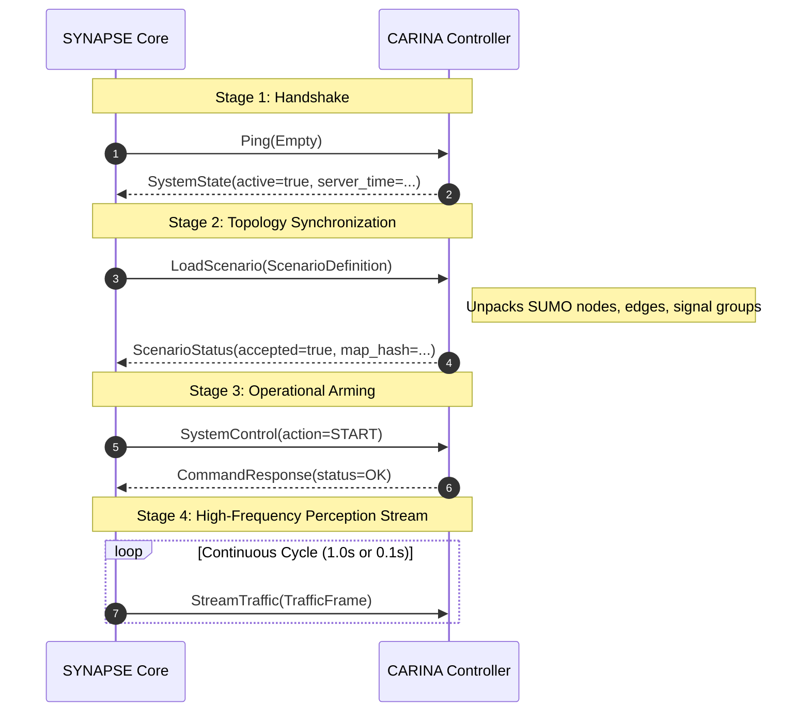

# 05. Data Ingestion & HFT Network

> **Heterogeneous Sensor Ingestion, Protocol Buffers v3, Sub-250ms gRPC Streaming, and Auto-Recovery Self-Healing**

---

> 🧭 **Navigation**:
> [🏠 Synapse Core](../README.md) • [📚 Docs Index](README.md) • [« Previous: 04. Execution Phases](04_execution_phases.md) • [Next: 06. Developer Guide »](06_developer_guide.md)

---

## 🌐 Overview

The I/O boundary of SYNAPSE is structured into two core responsibilities:
1. **Ingestion Pipeline ([`src/adapters/`](../src/README.md#subsystem-directory-breakdown))**: Asynchronously ingesting heterogeneous municipal telemetry (inductive loops, cameras, radars, Waze/TomTom cloud APIs).
2. **High-Frequency Transport Link (HFT-Link)**: Streaming fluid-dynamically validated present-state matrices to downstream macroscopic traffic signal controllers ([CARINA](https://github.com/noxfort/carina)) via high-throughput HTTP/2 gRPC.

```text
  [Field Sensors & APIs]
  Inductive Loops, Cameras, Radars, Waze, TomTom
            │  (HTTP Push/Poll, MQTT Stream, WebSocket)
            ▼
  ┌──────────────────────────────────────────────────┐
  │     src/adapters/ (IngestionHub & Adapters)      │
  │     - Schema normalizers & zero-trust buffer     │
  └─────────────────────────┬────────────────────────┘
                            │ Raw Datagrams
                            ▼
  ┌──────────────────────────────────────────────────┐
  │         Zero-Trust Ingestion Gatekeeper          │
  │     - DistilRoBERTa + Symbolic Physical Bounds   │
  └─────────────────────────┬────────────────────────┘
                            │ Validated MapNode State
                            ▼
  ┌──────────────────────────────────────────────────┐
  │       MARKVART™ Neural Continuum Pipeline        │
  │     - iTransformer + PINO + GATv2                │
  └─────────────────────────┬────────────────────────┘
                            │ Fused Traffic Snapshot
                            ▼
  ┌──────────────────────────────────────────────────┐
  │        HFT-Link gRPC Client (HTTP/2 Stream)      │
  │     - proto/synapse_hft.proto (< 250ms Latency)  │
  └─────────────────────────┬────────────────────────┘
                            │ Binary Protocol Buffers
                            ▼
               [CARINA Traffic Controller]
```

---

## 📥 1. The Ingestion Pipeline

### Modular Adapters (`src/adapters/`)
Sensor protocols subclass `BaseAdapter` (`src/interfaces/`):
- **`HttpPollingAdapter`**: Periodically fetches REST API endpoints (e.g. municipal open-data portals, Waze/TomTom congestion APIs).
- **`HttpPushAdapter`**: Lightweight micro-server receiving webhook pushes from smart city cameras and ANPR systems.
- **`MqttAdapter`**: Subscribes to urban IoT broker topics (e.g., `city/sensors/+/telemetry`).
- **`WebSocketAdapter`**: Continuous full-duplex socket for high-rate radar sensors.
- **`HistoricalReplayAdapter`**: Reads chronological Parquet logs for deterministic stress tests and validation.

### Canonical Device Alias Resolution & Edge Kinetics
- **`device_id_map` Canonical Resolution**: Field sensors often transmit hardware alias identifiers inside their JSON payload (e.g., `device_id: "loop_01"`) while registered under a canonical internal ID (`id: "src_2"`). `IngestionPipeline`, `IngestionHub.route_packet`, and `DataFlowRouter.handle_data_flow` automatically resolve aliases via `device_id_map` and support list/CSV coordinate strings in `ElementResolver`, ensuring uninterrupted routing to the associated `MapNode`/`MapEdge`.
- **Combined Flow/Count & Speed Extraction**: `EdgeHydrodynamicsEngine` extracts both macroscopic volume (`flow` / `count`) and direct speed fields (`speed_kmh`, `avg_speed_kmh`, `speed_ms`) from compound telemetry payloads, storing `measured_speed_ms` directly in `edge.jam_Translation[source_id]` alongside Greenshields density inversions.
- **Multi-Segment Global Jam Unpacking**: Global API payloads containing `jams` arrays (`line: [{x, y}, ...]`) are unpacked by `GraphManager._ingest_global_jams_feed`, projected into local metric coordinates, and matched per-segment via `FastMapMatcher`.
- **`HISTORICAL` Warmup Incident Isolation**: During initial warmup (`active_mode == "HISTORICAL"`), `EdgePayloadFormatter` suppresses localized `detection_list` incident emission (`jam_detected`) so CARINA receives a clean baseline until live telemetry (`ONLINE` / `HYBRID`) activates.

### Database Persistence (`src/infrastructure/postgres_manager.py`)
- Continuously dumps approved telemetry records into compressed columnar `.parquet` files partitioned by date (`year=YYYY/month=MM/day=DD/`).
- Supplies the [Phase 1 Bootstrap](04_execution_phases.md#phase-1-offline-bootstrap-bootstrap_phasepy) engine with historical Golden Datasets.

---

## ⚡ 2. The HFT-Link (High-Frequency Transport)

Located in [`src/hft/grpc_connector.py`](../src/hft/grpc_connector.py) and [`src/hft/hft_grpc_client.py`](../src/hft/hft_grpc_client.py), the HFT-Link guarantees uninterrupted, low-jitter perception delivery to CARINA.

### Channel Configuration & Performance Tuning
Because urban networks can comprise tens of thousands of intersections and road edges:
- **Maximum Message Size**: Set to **50 MB** (`50 * 1024 * 1024` bytes) for both transmission and reception to support uncompressed city-scale SUMO graphs:
  ```python
  ('grpc.max_send_message_length', 50 * 1024 * 1024),
  ('grpc.max_receive_message_length', 50 * 1024 * 1024),
  ```
- **KeepAlive Configuration**:
  - `keepalive_time_ms = 10000` (10s periodic heartbeats).
  - `keepalive_timeout_ms = 5000` (5s timeout before considering channel dead).
  - `http2.max_pings_without_data = 0` (Continuous keepalives even during quiet periods).

---

## 🔄 3. The 4-Stage Transmission Lifecycle



1. **Stage 1: Handshake (`Ping`)**: Verifies controller liveness and synchronizes high-precision UNIX timestamps.
2. **Stage 2: Scenario Upload (`LoadScenario`)**: Transmits the topological graph, compressed SUMO `.net.xml` geometry, and peak-hour schedule clusters.
3. **Stage 3: Operational Control (`SystemControl`)**: Transitions downstream controller states (`START`, `PAUSE`, `STOP`, `RESET`).
4. **Stage 4: Client-Streaming (`StreamTraffic`)**: Streams continuous `TrafficFrame` messages containing occupancy, mean velocity, and estimated queue lengths per edge.

---

## 🛡️ 4. Auto-Recovery Self-Healing Loop

In hostile physical networking conditions, edge links drop. SYNAPSE implements an automated self-healing loop in [`src/hft/hft_recovery.py`](../src/hft/hft_recovery.py):

1. **In-Memory Scenario Caching**: During Stage 2, SYNAPSE caches the serialized scenario binary payload (`_recovery_payload`).
2. **Exception Interception**: If gRPC raises `grpc.StatusCode.UNAVAILABLE` or `BrokenPipeError`, the core thread **does not abort**.
3. **Non-Blocking Reconnection Loop**: A background recovery thread attempts exponential backoff pings to CARINA.
4. **Transparent Re-Arming**: The instant the connection returns, SYNAPSE:
   - Re-executes `LoadScenario()` with the cached binary payload.
   - Issues `SystemControl(action=START)`.
   - Seamlessly resumes `StreamTraffic()` without dropping active sensor state or restarting PyTorch models.

---

## 🔒 5. High-Throughput Go Ingestion Gateway & Secure Reverse Tunnel

To handle line-rate raw sensor streams and provide secure external access without compromising host security:

1. **Go Ingestion Gateway (`src_go`)**:
   - Compiled CGO-free binary ([`bin/synapse-gateway`](../bin/synapse-gateway)) consuming high-velocity roadside cameras and IoT sensors with sub-millisecond socket latency.
   - Communicates with Python exclusively through zero-port anonymous OS pipes (`STDIN`/`STDOUT`) using NDJSON via [`src/go/subprocess_transport.py`](../src/go/subprocess_transport.py).
2. **Dynamic DNS (DuckDNS)**:
   - Automated driver (`src_go/internal/tunnel/duckdns.go`) synchronizing public IPv4/IPv6 addresses with DuckDNS every 10 minutes.
   - Managed seamlessly via `DuckDnsHandler` ([`src/handlers/duckdns_handler.py`](../src/handlers/duckdns_handler.py)) and the Desktop UI.
3. **Automated HTTPS Reverse Proxy (Caddy)**:
   - Embedded Caddy daemon ([`bin/caddy`](../bin/caddy)) orchestrated by `src_go/internal/tunnel/caddy.go`.
   - Dynamically writes [`config/Caddyfile`](../config/Caddyfile) with automatic TLS certificate issuance (Let's Encrypt / ZeroSSL), terminating HTTPS securely on port 443 before proxying traffic locally to the ingestion port.

---

> 🧭 **Next Chapter**: Set up developer tools and compile Protobufs in [06. Developer Guide](06_developer_guide.md).

---

<div align="center">
  <br/>
  <b>Noxfort Systems</b> — <i>A State Of Art Company</i><br/>
  <i>Intelligent Perception & Neural Fusion Gateway • SYNAPSE CORE v2.0</i><br/>
  <small>SPDX-License-Identifier: <a href="../LICENSE"><code>AGPL-3.0-or-later</code></a> • © 2026 Noxfort Systems</small>
</div>
