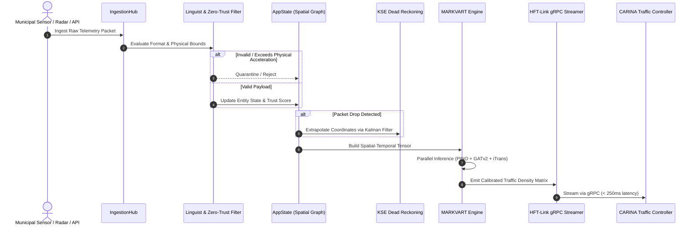

# 🏛️ SYNAPSE: Core Architecture & Multiprocess Model

This document specifies the technical architecture of **SYNAPSE CORE v2.0**: Domain-Driven Design (DDD), Clean Architecture layers, Zero-Port Stdio IPC, multi-agent pipeline topology, and real-time inference lifecycle.

⬅️ [Documentation Hub](README.md) | 🧠 [MARKVART™ Neural Stack](neural_models.md) | ⚡ [Data Ingestion & HFT](data_ingestion_and_hft.md)

---

## 1. Architectural Philosophy & DDD Principles

SYNAPSE adheres strictly to **Domain-Driven Design (DDD)**, **Hexagonal (Ports & Adapters)**, and **Clean Architecture** patterns. High-level domain logic and neural perception algorithms are completely decoupled from transport protocols (HTTP, MQTT, gRPC) and presentation layers (Tauri/React desktop UI).

```
                      ┌─────────────────────────────────┐
                      │    Desktop Frontend (Tauri v2)  │
                      └────────────────┬────────────────┘
                                       │ Stdio JSON-RPC IPC (Zero-Port)
                      ┌────────────────▼────────────────┐
                      │       StdioDaemon / IPC         │
                      └────────────────┬────────────────┘
                                       │
┌──────────────────────────────────────▼──────────────────────────────────────┐
│                              APPLICATION CORE                               │
│  ┌──────────────────────┐  ┌──────────────────────┐  ┌──────────────────┐   │
│  │     AppState Facade  │  │   Service Container  │  │   Event Bridge   │   │
│  └──────────┬───────────┘  └──────────┬───────────┘  └────────┬─────────┘   │
│             │                         │                       │             │
│  ┌──────────▼─────────────────────────▼───────────────────────▼──────────┐  │
│  │                              DOMAIN LAYER                             │  │
│  │  - Topology Entities (MapNode, MapEdge, Coordinate)                   │  │
│  │  - Source Entities (DataSource, SourceStatus, SensorTelemetry)        │  │
│  │  - Bayesian Trust Score Constants (LOCAL=0.95, GLOBAL=0.60)           │  │
│  └────────────────────────────────────┬──────────────────────────────────┘  │
│                                       │                                     │
│  ┌────────────────────────────────────▼──────────────────────────────────┐  │
│  │                         MARKVART™ NEURAL PIPELINE                     │  │
│  │  PINO-Traffic │ PI-DeepONet │ iTransformer │ GATv2 │ WaveletAE-OCC     │  │
│  └────────────────────────────────────┬──────────────────────────────────┘  │
└───────────────────────────────────────┼─────────────────────────────────────┘
                                        │ Snapshot Delivery (< 250ms)
                      ┌─────────────────▼─────────────────┐
                      │      HFT-Link (gRPC Streamer)     │
                      └─────────────────┬─────────────────┘
                                        │ HTTP/2 Protobuf
                      ┌─────────────────▼─────────────────┐
                      │   CARINA Controller Downstream    │
                      └───────────────────────────────────┘
```

---

## 2. Key Design Patterns

### The Facade Pattern: `AppState` & `StdioDaemon`
- **`AppState` (`src/domain/app_state.py`)**: Acts as a synchronized, thread-safe facade protecting the `TopologyRepository` and `SourceRepository`. External actors cannot bypass validation checks; all data updates pass through `AppState` to maintain strict Zero-Trust boundaries.
- **`StdioDaemon` (`src/ipc/stdio_daemon.py`)**: Headless facade coordinating standard input/output streams, parsing newline-delimited JSON-RPC requests, and emitting domain events without exposing any TCP socket on the local host.

### The Strategy & State Patterns: `SourceStatus`
Data sources transition through a formal finite-state machine:
$$\text{QUARANTINE} \longrightarrow \text{VALIDATING} \longrightarrow \text{ACTIVE} \rightleftharpoons \text{FALLBACK} \longrightarrow \text{PROBATION} \lor \text{REJECTED}$$

- **`QUARANTINE`**: Initial state for newly connected or suspicious sensors.
- **`VALIDATING`**: Running sanity bounds and physical rate-of-change checks.
- **`ACTIVE`**: Full real-time inclusion in neural tensor construction.
- **`FALLBACK`**: Graceful degradation to KSE Kinematic Dead Reckoning upon packet timeout.

### Dependency Inversion & IoC Container
Components interact through abstractions defined in `src/domain/interfaces.py`. The `ServiceContainer` injects repositories, neural runners, and transport managers into high-level controllers, enabling unit testing on CPU without requiring live hardware or GPU clusters.

---

## 3. High-Frequency Data Flow Sequence



---

## 4. Multi-Process Isolation & F.E.N.I.X. Resilience

To eliminate Python GIL contention and guarantee uninterrupted operational safety:
1. **Inference Loop**: Dedicated process running PyTorch tensor operations with CUDA streams.
2. **IPC Stdio Server**: Dedicated asynchronous loop handling UI queries and commands.
3. **F.E.N.I.X. Supervisor**: Independent watchdog monitoring process heartbeats, memory usage, and executing crash recovery within 500 ms.

---

<div align="center">
  <br/>
  <b>Noxfort Systems</b> — <i>A State Of Art Company</i><br/>
  <i>Intelligent Perception & Neural Fusion Gateway • SYNAPSE CORE v2.0</i><br/>
  <small>SPDX-License-Identifier: <a href="../../LICENSE"><code>AGPL-3.0-or-later</code></a> • © 2026 Noxfort Systems</small>
</div>
