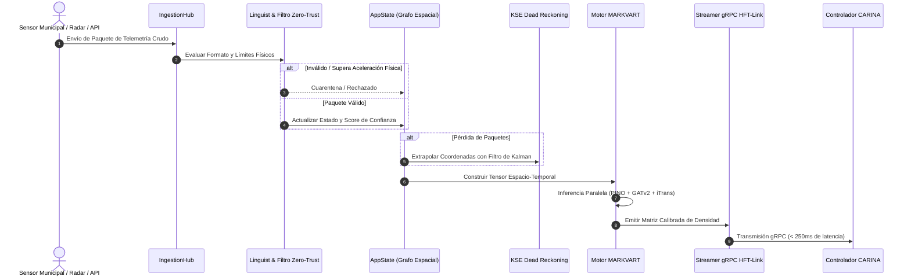

# 🏛️ SYNAPSE: Arquitectura Central y Modelo Multiproceso

Este documento detalla la arquitectura técnica de **SYNAPSE CORE v2.0**: separación de capas Clean Architecture y DDD, IPC Stdio sin apertura de puertos (Zero-Port), topología de pipelines multi-agente y ciclo de inferencia en tiempo real.

⬅️ [Centro de Documentación](README.md) | 🧠 [Stack Neural MARKVART™](neural_models.md) | ⚡ [Ingestión y HFT](data_ingestion_and_hft.md)

---

## 1. Filosofía Arquitectónica y Principios DDD

SYNAPSE implementa estrictamente **Domain-Driven Design (DDD)**, **Arquitectura Hexagonal (Ports & Adapters)** y **Clean Architecture**. La lógica central de dominio y los motores de percepción neuronal están totalmente desacoplados de los protocolos de transporte y de la interfaz gráfica de usuario.

```
                      ┌─────────────────────────────────┐
                      │   Frontend Desktop (Tauri v2)   │
                      └────────────────┬────────────────┘
                                       │ Stdio JSON-RPC IPC (Zero-Port)
                      ┌────────────────▼────────────────┐
                      │       StdioDaemon / IPC         │
                      └────────────────┬────────────────┘
                                       │
┌──────────────────────────────────────▼──────────────────────────────────────┐
│                              NÚCLEO DE APLICACIÓN                           │
│  ┌──────────────────────┐  ┌──────────────────────┐  ┌──────────────────┐   │
│  │   Fachada AppState   │  │ Contenedor Servicios │  │   Event Bridge   │   │
│  └──────────┬───────────┘  └──────────┬───────────┘  └────────┬─────────┘   │
│             │                         │                       │             │
│  ┌──────────▼─────────────────────────▼───────────────────────▼──────────┐  │
│  │                              CAPA DE DOMINIO                          │  │
│  │  - Entidades Topológicas (MapNode, MapEdge, Coordinate)               │  │
│  │  - Entidades de Fuente (DataSource, SourceStatus, SensorTelemetry)     │  │
│  │  - Constantes de Confianza Bayesiana (LOCAL=0.95, GLOBAL=0.60)        │  │
│  └────────────────────────────────────┬──────────────────────────────────┘  │
│                                       │                                     │
│  ┌────────────────────────────────────▼──────────────────────────────────┐  │
│  │                        PIPELINE NEURAL MARKVART™                      │  │
│  │  PINO-Traffic │ PI-DeepONet │ iTransformer │ GATv2 │ WaveletAE-OCC     │  │
│  └────────────────────────────────────┬──────────────────────────────────┘  │
└───────────────────────────────────────┼─────────────────────────────────────┘
                                        │ Emisión de Snapshots (< 250ms)
                      ┌─────────────────▼─────────────────┐
                      │      HFT-Link (Streamer gRPC)     │
                      └─────────────────┬─────────────────┘
                                        │ HTTP/2 Protobuf
                      ┌─────────────────▼─────────────────┐
                      │   Controlador CARINA Descendente  │
                      └───────────────────────────────────┘
```

---

## 2. Patrones de Diseño Aplicados

### Patrón Fachada (Facade): `AppState` y `StdioDaemon`
- **`AppState` (`src/domain/app_state.py`)**: Fachada sincronizada y segura contra hilos que protege los repositorios de topología y fuentes. Todas las actualizaciones pasan por rigurosas verificaciones Zero-Trust antes de modificar la memoria.
- **`StdioDaemon` (`src/ipc/stdio_daemon.py`)**: Fachada headless que gestiona los canales estándar de entrada y salida (STDIN/STDOUT), procesando comandos JSON-RPC sin exponer puertos TCP en la máquina anfitriona.

### Máquina de Estados: `SourceStatus`
Las fuentes sensoriales transitan formalmente a través de estados finitos:
$$\text{QUARANTINE} \longrightarrow \text{VALIDATING} \longrightarrow \text{ACTIVE} \rightleftharpoons \text{FALLBACK} \longrightarrow \text{PROBATION} \lor \text{REJECTED}$$

- **`QUARANTINE`**: Estado inicial para sensores nuevos o sospechosos.
- **`VALIDATING`**: Comprobación de límites físicos y tasa de variación temporal.
- **`ACTIVE`**: Integración directa en los tensores neuronales en tiempo real.
- **`FALLBACK`**: Degradación fluida a estimación cinemática KSE ante pérdida de paquetes.

---

## 3. Flujo de Datos de Alta Frecuencia



---

## 4. Aislamiento Multiproceso y Resiliencia F.E.N.I.X.

Para superar el Global Interpreter Lock (GIL) de Python y mantener una operación ininterrumpida:
1. **Bucle de Inferencia**: Proceso aislado que ejecuta operaciones de tensores PyTorch mediante CUDA Streams.
2. **Servidor IPC Stdio**: Proceso asíncrono dedicado a la atención de peticiones de la interfaz de usuario.
3. **Supervisor F.E.N.I.X.**: Watchdog independiente que monitorea señales de vida (heartbeats), consumo de memoria RAM y ejecuta reanudación en $< 500\text{ ms}$ en caso de contingencia.

---

<div align="center">
  <br/>
  <b>Noxfort Systems</b> — <i>A State Of Art Company</i><br/>
  <i>Intelligent Perception & Neural Fusion Gateway • SYNAPSE CORE v2.0</i><br/>
  <small>SPDX-License-Identifier: <a href="../../LICENSE"><code>AGPL-3.0-or-later</code></a> • © 2026 Noxfort Systems</small>
</div>
