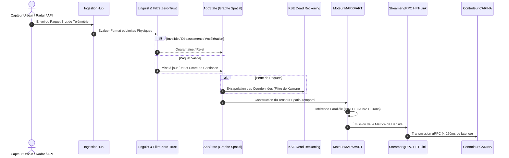

# 🏛️ SYNAPSE: Architecture Système et Modèle Multiprocessus

Ce document détaille l'architecture technique de **SYNAPSE CORE v2.0** : conception DDD et Clean Architecture, IPC Stdio sans port réseau ouvert (Zero-Port), topologie multi-agents et inférence en temps réel.

⬅️ [Hub de Documentation](README.md) | 🧠 [Stack Neuronal MARKVART™](neural_models.md) | ⚡ [Ingestion et HFT](data_ingestion_and_hft.md)

---

## 1. Philosophie d'Architecture et Principes DDD

SYNAPSE respecte rigoureusement les principes de **Domain-Driven Design (DDD)**, d'**Architecture Hexagonale** et de **Clean Architecture**. La logique métier et les réseaux neuronaux sont complètement dissociés des protocoles de communication et de l'interface graphique.

```
                      ┌─────────────────────────────────┐
                      │    Interface Desktop (Tauri v2) │
                      └────────────────┬────────────────┘
                                       │ Stdio JSON-RPC IPC (Zero-Port)
                      ┌────────────────▼────────────────┐
                      │       StdioDaemon / IPC         │
                      └────────────────┬────────────────┘
                                       │
┌──────────────────────────────────────▼──────────────────────────────────────┐
│                              CŒUR D'APPLICATION                             │
│  ┌──────────────────────┐  ┌──────────────────────┐  ┌──────────────────┐   │
│  │   Façade AppState    │  │  Conteneur Services  │  │   Event Bridge   │   │
│  └──────────┬───────────┘  └──────────┬───────────┘  └────────┬─────────┘   │
│             │                         │                       │             │
│  ┌──────────▼─────────────────────────▼───────────────────────▼──────────┐  │
│  │                              COUCHE DOMAINE                           │  │
│  │  - Entités Topologiques (MapNode, MapEdge, Coordinate)                │  │
│  │  - Entités Sources (DataSource, SourceStatus, SensorTelemetry)        │  │
│  │  - Constantes de Confiance Bayésienne (LOCAL=0.95, GLOBAL=0.60)       │  │
│  └────────────────────────────────────┬──────────────────────────────────┘  │
│                                       │                                     │
│  ┌────────────────────────────────────▼──────────────────────────────────┐  │
│  │                         PIPELINE NEURONAL MARKVART™                   │  │
│  │  PINO-Traffic │ PI-DeepONet │ iTransformer │ GATv2 │ WaveletAE-OCC     │  │
│  └────────────────────────────────────┬──────────────────────────────────┘  │
└───────────────────────────────────────┼─────────────────────────────────────┘
                                        │ Transmission Snapshots (< 250ms)
                      ┌─────────────────▼─────────────────┐
                      │      HFT-Link (Streamer gRPC)     │
                      └─────────────────┬─────────────────┘
                                        │ HTTP/2 Protobuf
                      ┌─────────────────▼─────────────────┐
                      │    Régulateur CARINA en Aval      │
                      └───────────────────────────────────┘
```

---

## 2. Patrons de Conception Clés

### Patron Façade : `AppState` et `StdioDaemon`
- **`AppState` (`src/domain/app_state.py`)**: Façade synchronisée et thread-safe qui isole les dépôts de topologie et de capteurs. Aucune donnée n'est altérée directement en mémoire sans validation préalable Zero-Trust.
- **`StdioDaemon` (`src/ipc/stdio_daemon.py`)**: Façade sans interface qui gère les flux standard d'entrée/sortie (STDIN/STDOUT), traitant les messages JSON-RPC sans exposer de port réseau TCP.

### Automate d'États : `SourceStatus`
Les sources de données transitent par un automate formel :
$$\text{QUARANTINE} \longrightarrow \text{VALIDATING} \longrightarrow \text{ACTIVE} \rightleftharpoons \text{FALLBACK} \longrightarrow \text{PROBATION} \lor \text{REJECTED}$$

- **`QUARANTINE`** : État initial d'isolement lors de la détection d'un capteur.
- **`VALIDATING`** : Évaluation de la plausibilité physique et du taux de variation.
- **`ACTIVE`** : Prise en compte directe dans la génération des tenseurs.
- **`FALLBACK`** : Dégradation fluide vers l'extrapolation cinématique KSE en cas d'interruption.

---

## 3. Flux Haute Fréquence de Télémétrie



---

## 4. Isolation Multiprocessus et Résilience F.E.N.I.X.

Pour s'affranchir du Global Interpreter Lock (GIL) de Python et garantir une stabilité continue :
1. **Boucle d'Inférence** : Processus dédié exécutant les calculs de tenseurs PyTorch via des CUDA Streams.
2. **Serveur IPC Stdio** : Processus asynchrone assigné au traitement des commandes de l'interface utilisateur.
3. **Superviseur F.E.N.I.X.** : Watchdog indépendant assurant le suivi des signaux de vie (heartbeats), du plafond mémoire et du redémarrage en $< 500\text{ ms}$.

---

<div align="center">
  <br/>
  <b>Noxfort Systems</b> — <i>A State Of Art Company</i><br/>
  <i>Intelligent Perception & Neural Fusion Gateway • SYNAPSE CORE v2.0</i><br/>
  <small>SPDX-License-Identifier: <a href="../../LICENSE"><code>AGPL-3.0-or-later</code></a> • © 2026 Noxfort Systems</small>
</div>
