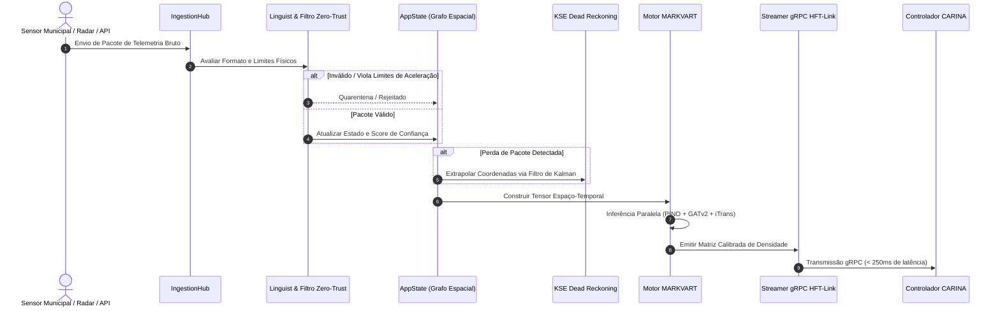

# 🏛️ SYNAPSE: Arquitetura Central e Modelo Multiprocesso

Este documento detalha a arquitetura técnica do **SYNAPSE CORE v2.0**: separação em camadas Clean Architecture e DDD, IPC Stdio de Porta Zero, topologia de pipelines multiagente e ciclo de inferência em tempo real.

⬅️ [Central de Documentação](README.md) | 🧠 [Stack Neural MARKVART™](neural_models.md) | ⚡ [Ingestão e HFT](data_ingestion_and_hft.md)

---

## 1. Filosofia de Arquitetura e Princípios DDD

O SYNAPSE segue rigorosamente os padrões de **Domain-Driven Design (DDD)**, **Arquitetura Hexagonal (Ports & Adapters)** e **Clean Architecture**. A lógica de domínio e os motores de percepção neural são totalmente desacoplados dos protocolos de transporte (HTTP, MQTT, gRPC) e das interfaces de apresentação gráfica (Tauri/React).

```
                      ┌─────────────────────────────────┐
                      │    Frontend Desktop (Tauri v2)  │
                      └────────────────┬────────────────┘
                                       │ Stdio JSON-RPC IPC (Porta Zero)
                      ┌────────────────▼────────────────┐
                      │       StdioDaemon / IPC         │
                      └────────────────┬────────────────┘
                                       │
┌──────────────────────────────────────▼──────────────────────────────────────┐
│                              NÚCLEO DA APLICAÇÃO                            │
│  ┌──────────────────────┐  ┌──────────────────────┐  ┌──────────────────┐   │
│  │   Fachada AppState   │  │  Contêiner Serviços  │  │   Event Bridge   │   │
│  └──────────┬───────────┘  └──────────┬───────────┘  └────────┬─────────┘   │
│             │                         │                       │             │
│  ┌──────────▼─────────────────────────▼───────────────────────▼──────────┐  │
│  │                              CAMADA DE DOMÍNIO                        │  │
│  │  - Entidades Topológicas (MapNode, MapEdge, Coordinate)               │  │
│  │  - Entidades de Fonte (DataSource, SourceStatus, SensorTelemetry)     │  │
│  │  - Constantes de Confiança Bayesiana (LOCAL=0.95, GLOBAL=0.60)        │  │
│  └────────────────────────────────────┬──────────────────────────────────┘  │
│                                       │                                     │
│  ┌────────────────────────────────────▼──────────────────────────────────┐  │
│  │                         PIPELINE NEURAL MARKVART™                     │  │
│  │  PINO-Traffic │ PI-DeepONet │ iTransformer │ GATv2 │ WaveletAE-OCC     │  │
│  └────────────────────────────────────┬──────────────────────────────────┘  │
└───────────────────────────────────────┼─────────────────────────────────────┘
                                        │ Envio de Snapshots (< 250ms)
                      ┌─────────────────▼─────────────────┐
                      │      HFT-Link (Streamer gRPC)     │
                      └─────────────────┬─────────────────┘
                                        │ HTTP/2 Protobuf
                      ┌─────────────────▼─────────────────┐
                      │   Controlador CARINA a Jusante    │
                      └───────────────────────────────────┘
```

---

## 2. Padrões de Projeto Aplicados

### Padrão Fachada (Facade): `AppState` e `StdioDaemon`
- **`AppState` (`src/domain/app_state.py`)**: Fachada thread-safe que encapsula `TopologyRepository` e `SourceRepository`. Nenhum serviço externo manipula dados diretamente na memória; todas as atualizações passam por validações estritas de Zero-Trust no `AppState`.
- **`StdioDaemon` (`src/ipc/stdio_daemon.py`)**: Fachada headless que gerencia os fluxos de entrada e saída padrão (STDIN/STDOUT), processa mensagens JSON-RPC delimitadas por quebra de linha e transmite eventos sem abrir portas TCP na máquina local.

### Padrão Estratégia e Estado: `SourceStatus`
As fontes de telemetria transitam por uma máquina de estados finita formal:
$$\text{QUARANTINE} \longrightarrow \text{VALIDATING} \longrightarrow \text{ACTIVE} \rightleftharpoons \text{FALLBACK} \longrightarrow \text{PROBATION} \lor \text{REJECTED}$$

- **`QUARANTINE`**: Estado inicial para sensores recém-conectados ou suspeitos.
- **`VALIDATING`**: Execução de testes de plausibilidade física e taxa de variação.
- **`ACTIVE`**: Inclusão direta na geração de tensores neurais em tempo real.
- **`FALLBACK`**: Degradação para KSE Dead Reckoning após perda de pacotes.

---

## 3. Fluxo de Dados de Alta Frequência



---

## 4. Isolamento Multiprocesso e Auto-Recuperação F.E.N.I.X.

Para contornar o Global Interpreter Lock (GIL) do Python e manter estabilidade ininterrupta:
1. **Loop de Inferência**: Processo isolado executando operações de tensores PyTorch via CUDA Streams.
2. **Servidor IPC Stdio**: Processo assíncrono dedicado ao atendimento das requisições da interface de usuário.
3. **Supervisor F.E.N.I.X.**: Watchdog independente que monitora heartbeats, teto de memória RAM e executa reinicialização em $< 500\text{ ms}$ em caso de falha crítica.

---

<div align="center">
  <br/>
  <b>Noxfort Systems</b> — <i>A State Of Art Company</i><br/>
  <i>Intelligent Perception & Neural Fusion Gateway • SYNAPSE CORE v2.0</i><br/>
  <small>SPDX-License-Identifier: <a href="../../LICENSE"><code>AGPL-3.0-or-later</code></a> • © 2026 Noxfort Systems</small>
</div>
