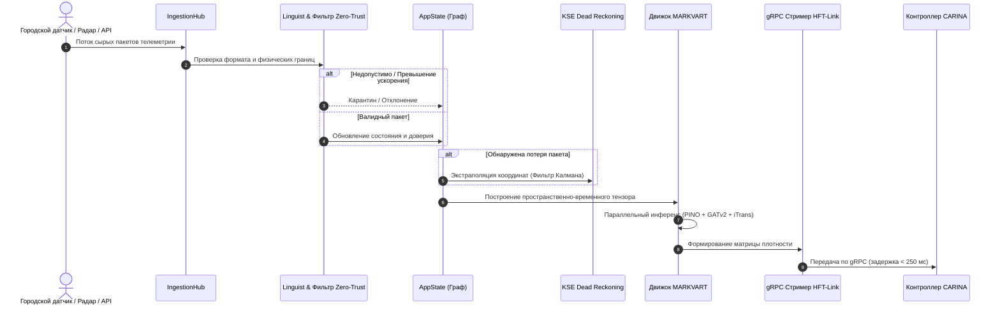

# 🏛️ SYNAPSE: Архитектура системы и многопроцессная модель

Данный документ содержит техническое описание архитектуры **SYNAPSE CORE v2.0**: принципы Domain-Driven Design (DDD), чистая архитектура (Clean Architecture), бессерверный межпроцессный обмен Stdio JSON-RPC (Zero-Port) и высокочастотный цикл инференса.

⬅️ [Главный Хаб](README.md) | 🧠 [Нейростек MARKVART™](neural_models.md) | ⚡ [Сбор данных и HFT](data_ingestion_and_hft.md)

---

## 1. Философия архитектуры и принципы DDD

SYNAPSE строго придерживается принципов **Domain-Driven Design (DDD)**, **Гексагональной архитектуры (порты и адаптеры)** и **Clean Architecture**. Доменная логика и нейросетевые алгоритмы восприятия полностью изолированы от протоколов передачи (HTTP, MQTT, gRPC) и десктопного графического интерфейса.

```
                      ┌─────────────────────────────────┐
                      │  Десктопный клиент (Tauri v2)   │
                      └────────────────┬────────────────┘
                                       │ Stdio JSON-RPC IPC (Zero-Port)
                      ┌────────────────▼────────────────┐
                      │       StdioDaemon / IPC         │
                      └────────────────┬────────────────┘
                                       │
┌──────────────────────────────────────▼──────────────────────────────────────┐
│                              ЯДРО ПРИЛОЖЕНИЯ                                │
│  ┌──────────────────────┐  ┌──────────────────────┐  ┌──────────────────┐   │
│  │   Фасад AppState     │  │  Контейнер Сервисов  │  │   Event Bridge   │   │
│  └──────────┬───────────┘  └──────────┬───────────┘  └────────┬─────────┘   │
│             │                         │                       │             │
│  ┌──────────▼─────────────────────────▼───────────────────────▼──────────┐  │
│  │                              ДОМЕННЫЙ СЛОЙ                            │  │
│  │  - Топологические сущности (MapNode, MapEdge, Coordinate)             │  │
│  │  - Сущности источников (DataSource, SourceStatus, SensorTelemetry)    │  │
│  │  - Константы байесовского доверия (LOCAL=0.95, GLOBAL=0.60)           │  │
│  └────────────────────────────────────┬──────────────────────────────────┘  │
│                                       │                                     │
│  ┌────────────────────────────────────▼──────────────────────────────────┐  │
│  │                         НЕЙРОСЕТЕВОЙ ПАЙПЛАЙН MARKVART™               │  │
│  │  PINO-Traffic │ PI-DeepONet │ iTransformer │ GATv2 │ WaveletAE-OCC     │  │
│  └────────────────────────────────────┬──────────────────────────────────┘  │
└───────────────────────────────────────┼─────────────────────────────────────┘
                                        │ Передача слепков (< 250мс)
                      ┌─────────────────▼─────────────────┐
                      │      HFT-Link (Стример gRPC)      │
                      └─────────────────┬─────────────────┘
                                        │ HTTP/2 Protobuf
                      ┌─────────────────▼─────────────────┐
                      │   Контроллер CARINA (Приемник)    │
                      └───────────────────────────────────┘
```

---

## 2. Ключевые паттерны проектирования

### Паттерн Фасад: `AppState` и `StdioDaemon`
- **`AppState` (`src/domain/app_state.py`)**: Потокобезопасный фасад, защищающий репозитории топологии и источников. Внешние сервисы не имеют прямого доступа к памяти; все обновления проходят проверку Zero-Trust.
- **`StdioDaemon` (`src/ipc/stdio_daemon.py`)**: Фоновый фасад, управляющий стандартными потоками ввода/вывода (STDIN/STDOUT), разбирающий JSON-RPC сообщения без открытия сетевых TCP-портов на хосте.

### Конечный автомат: `SourceStatus`
Источники данных переходят между формальными состояниями:
$$\text{QUARANTINE} \longrightarrow \text{VALIDATING} \longrightarrow \text{ACTIVE} \rightleftharpoons \text{FALLBACK} \longrightarrow \text{PROBATION} \lor \text{REJECTED}$$

- **`QUARANTINE`**: Начальный карантин для новых или подозрительных датчиков.
- **`VALIDATING`**: Проверка физических границ и предельной скорости изменения.
- **`ACTIVE`**: Прямое включение в расчет нейросетевых тензоров реального времени.
- **`FALLBACK`**: Плавная деградация к кинематическому счислению KSE при потере пакетов.

---

## 3. Высокочастотный поток телеметрии



---

## 4. Многопроцессная изоляция и F.E.N.I.X.

Для преодоления ограничений Python GIL и обеспечения непрерывной надежности:
1. **Цикл инференса**: Изолированный процесс, выполняющий операции PyTorch с использованием CUDA Streams.
2. **Сервер IPC Stdio**: Асинхронный процесс, выделенный под запросы пользовательского интерфейса.
3. **Супервизор F.E.N.I.X.**: Независимый watchdog-процесс, отслеживающий сигналы жизнеспособности (heartbeats), память и перезапускающий модули менее чем за 500 мс при сбоях.

---

<div align="center">
  <br/>
  <b>Noxfort Systems</b> — <i>A State Of Art Company</i><br/>
  <i>Intelligent Perception & Neural Fusion Gateway • SYNAPSE CORE v2.0</i><br/>
  <small>SPDX-License-Identifier: <a href="../../LICENSE"><code>AGPL-3.0-or-later</code></a> • © 2026 Noxfort Systems</small>
</div>
