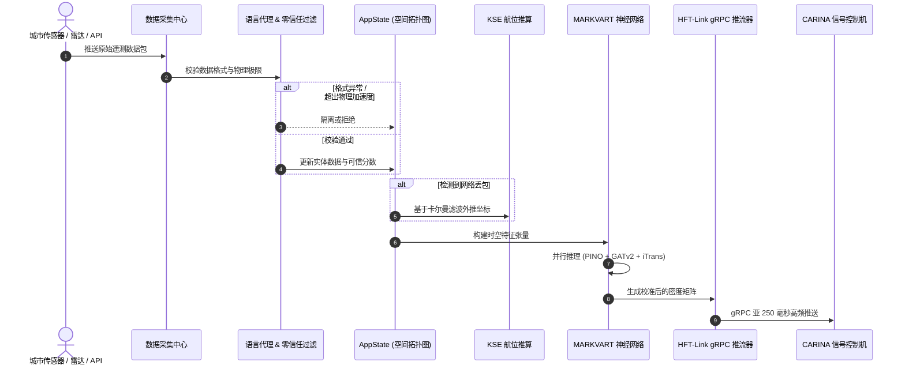

# 🏛️ SYNAPSE: 系统架构核心蓝图与多进程并发模型

本规范详细阐述 **SYNAPSE CORE v2.0** 的底层工程架构：领域驱动设计 (DDD)、整洁分层架构、零开放网络端口 Stdio JSON-RPC 通信机制、多智能体协同流水线与高频流式推理。

⬅️ [文档总中心](README.md) | 🧠 [MARKVART™ 神经网络群](neural_models.md) | ⚡ [数据采集与 HFT](data_ingestion_and_hft.md)

---

## 1. 架构设计哲学与 DDD 领域原则

SYNAPSE 严格贯彻**领域驱动设计 (DDD)**、**六边形架构 (端口与适配器)**与**整洁架构 (Clean Architecture)** 原则。核心领域业务规则与深度感知算法与数据传输协议（HTTP、MQTT、gRPC）及前端桌面界面（Tauri/React）实现彻底解耦。

```
                      ┌─────────────────────────────────┐
                      │    桌面客户端 (Tauri v2)        │
                      └────────────────┬────────────────┘
                                       │ 零端口 Stdio JSON-RPC IPC
                      ┌────────────────▼────────────────┐
                      │       StdioDaemon / IPC         │
                      └────────────────┬────────────────┘
                                       │
┌──────────────────────────────────────▼──────────────────────────────────────┐
│                                 应用核心层                                  │
│  ┌──────────────────────┐  ┌──────────────────────┐  ┌──────────────────┐   │
│  │   AppState 门面      │  │      服务容器        │  │     事件桥接     │   │
│  └──────────┬───────────┘  └──────────┬───────────┘  └────────┬─────────┘   │
│             │                         │                       │             │
│  ┌──────────▼─────────────────────────▼───────────────────────▼──────────┐  │
│  │                               领域层                                  │  │
│  │  - 拓扑图实体 (MapNode, MapEdge, Coordinate)                          │  │
│  │  - 传感器源实体 (DataSource, SourceStatus, SensorTelemetry)           │  │
│  │  - 贝叶斯先验可信度常数 (LOCAL=0.95, GLOBAL=0.60)                    │  │
│  └────────────────────────────────────┬──────────────────────────────────┘  │
│                                       │                                     │
│  ┌────────────────────────────────────▼──────────────────────────────────┐  │
│  │                        MARKVART™ 神经网络流水线                       │  │
│  │  PINO-Traffic │ PI-DeepONet │ iTransformer │ GATv2 │ WaveletAE-OCC     │  │
│  └────────────────────────────────────┬──────────────────────────────────┘  │
└───────────────────────────────────────┼─────────────────────────────────────┘
                                        │ 交通快照推送 (< 250ms)
                      ┌─────────────────▼─────────────────┐
                      │      HFT-Link (gRPC 推流器)       │
                      └─────────────────┬─────────────────┘
                                        │ HTTP/2 Protobuf
                      ┌─────────────────▼─────────────────┐
                      │    下游 CARINA 自适应控制机       │
                      └───────────────────────────────────┘
```

---

## 2. 核心设计模式

### 门面模式 (Facade): `AppState` 与 `StdioDaemon`
- **`AppState` (`src/domain/app_state.py`)**：线程安全的全局同步门面，统一封装拓扑与数据源仓库。外部模块严禁直接修改内存数据，必须经过严格的零信任校验机制。
- **`StdioDaemon` (`src/ipc/stdio_daemon.py`)**：无头驻留门面，通过操作系统标准输入/输出流 (STDIN/STDOUT) 处理换行分隔的 JSON-RPC 指令，杜绝在宿主机上暴露本地 TCP 端口。

### 状态机模式: `SourceStatus`
传感器数据源在严格的有限状态机中转换：
$$\text{QUARANTINE} \longrightarrow \text{VALIDATING} \longrightarrow \text{ACTIVE} \rightleftharpoons \text{FALLBACK} \longrightarrow \text{PROBATION} \lor \text{REJECTED}$$

- **`QUARANTINE` (隔离)**：新接入或出现指标波动的初始检测状态。
- **`VALIDATING` (校验)**：物理合理性边界与加速度瞬变测试。
- **`ACTIVE` (激活)**：直接参与实时张量构建与深度推理。
- **`FALLBACK` (后备)**：丢包时自动降级至 KSE 航位推算。

---

## 3. 高频数据流时序



---

## 4. 多进程并发隔离与 F.E.N.I.X. 自愈

为规避 Python 全局解释器锁 (GIL) 并保障市政核心设施绝对安全：
1. **推理循环主进程**：独立专职进程，基于 PyTorch 与 CUDA Streams 执行高效张量运算。
2. **IPC Stdio 交互进程**：专用于响应前端桌面界面的查询与控制指令。
3. **F.E.N.I.X. 独立看门狗**：外部常驻监控进程，监测各模块心跳与内存峰值，确保在发生异常时能在 500 毫秒内完成自动复原。

---

<div align="center">
  <br/>
  <b>Noxfort Systems</b> — <i>A State Of Art Company</i><br/>
  <i>Intelligent Perception & Neural Fusion Gateway • SYNAPSE CORE v2.0</i><br/>
  <small>SPDX-License-Identifier: <a href="../../LICENSE"><code>AGPL-3.0-or-later</code></a> • © 2026 Noxfort Systems</small>
</div>
